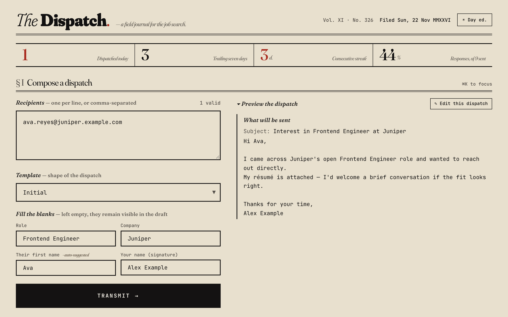
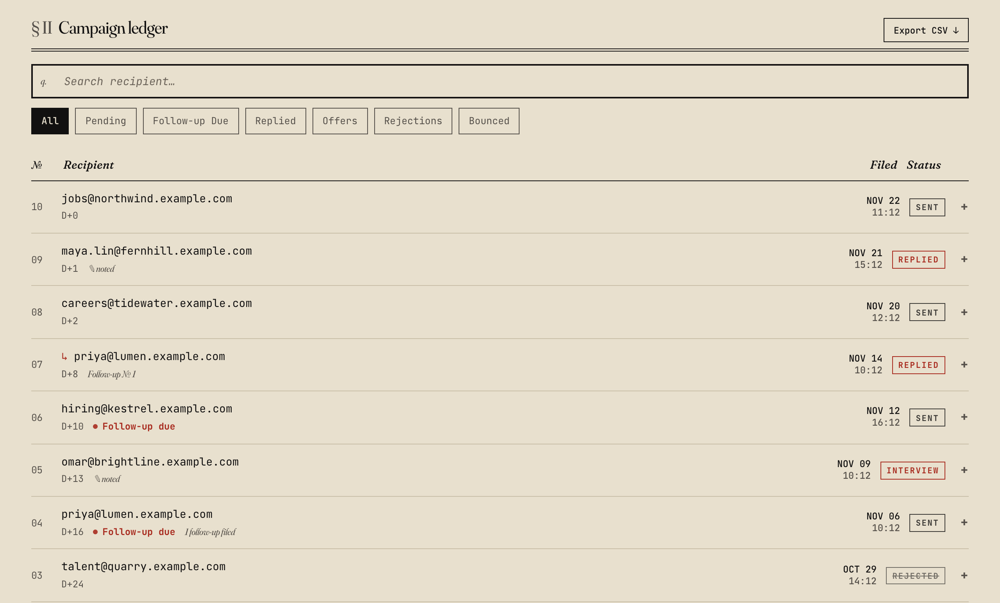

# The Dispatch

> *A local-only, zero-cost field journal for your job search.*
> Compose, send, and track cold-application emails — from your own Gmail, on your own machine. No accounts, no cloud, no telemetry.




<sub>Shown with made-up demo data.</sub>

---

## Why

Most job-application tools are either SaaS (you hand over your Gmail credentials and pay $X/month) or generic mail-merges that don't track the part that matters after the send: replies, interviews, follow-ups, the aging of silent applications.

The Dispatch runs entirely on your laptop:

- **Your Gmail** sends the email (via SMTP with an App Password — not a third-party relay).
- **Your filesystem** stores templates, send history, and notes. No database, no sync.
- **Your clock** is the only clock. Follow-ups, streaks, and stats are computed from the local ledger.

Nothing about your campaign ever leaves your machine.

## Features

### Sending
- Single-recipient or bulk send (paste many addresses at once)
- Multiple editable email templates under `data/templates/`
- Token substitution: `{{company}}`, `{{role}}`, `{{first_name}}`, `{{sender_name}}`, `{{job_url}}`, or any custom token
- **Auto-suggest** company from the recipient's domain (`jobs@acme-corp.io` → "Acme Corp") and first name from the local-part (`alex.chen@…` → "Alex")
- Preview the rendered subject + body before sending; unfilled `{{tokens}}` stay visible so mistakes are loud
- Resume + arbitrary extra attachments
- Confirmation step with explicit warning about unfilled tokens

### Tracking (the ledger)
- **Pipeline status per record** — click the status tag to cycle SENT → REPLIED → INTERVIEW → OFFER / REJECTED / GHOSTED (shift-click reverses)
- **Follow-up aging** — red pulsing "DUE" marker on sent entries 7+ days old with no reply marked
- **Inline notes** — per-record marginalia (interview dates, referrers, prep notes)
- **Follow-up flow** — one-click "Compose follow-up" from any ledger row, auto-picks the follow-up template, threads the reply to its parent
- **Search + filter** — search recipient, filter by All / Pending / Follow-up Due / Replied / Offers / Rejections / Bounced
- **CSV export** — download the full ledger (including pipeline + notes) for analysis or backup
- **Editorial stats strip** — Dispatched today / trailing 7 days / consecutive streak / response rate
- **Day / Night editions** — cream-paper light mode, deep-ink dark mode

### Keyboard
- `⌘K` / `Ctrl+K` focuses the compose field

## Privacy

- `.env` holds your Gmail App Password — gitignored, never committed.
- `data/send-log.json` is your personal ledger — gitignored, never committed.
- Pipeline statuses and notes live in your browser's `localStorage`, not on any server.
- No analytics, no crash reporting, no tracking pixels. This repo has zero external dependencies at runtime beyond `smtp.gmail.com`.

## Quick start

### Prerequisites

- [Bun](https://bun.sh) v1.2+
- A Gmail account with [an App Password](https://myaccount.google.com/apppasswords) (requires 2FA enabled on the account)

### Install

```bash
git clone https://github.com/yashsuhagiya/dispatch.git
cd dispatch
bun install
cp .env.example .env
```

Edit `.env`:

```dotenv
GMAIL_USER=you@gmail.com
GMAIL_APP_PASSWORD=xxxx xxxx xxxx xxxx
EMAIL_SUBJECT=Software Engineer Application
EMAIL_BODY_PATH=/absolute/path/to/email-body.txt
RESUME_PATH=/absolute/path/to/resume.pdf
# Optional — extra attachments, comma-separated absolute paths
ATTACHMENTS=/path/to/cover-letter.pdf
PORT=3000
```

| Variable | Required | Description |
|---|---|---|
| `GMAIL_USER` | Yes | Your Gmail address — also what recipients see as "From:" |
| `GMAIL_APP_PASSWORD` | Yes | A Gmail App Password (not your account password) |
| `EMAIL_SUBJECT` | Yes | Fallback subject when a template doesn't define one |
| `EMAIL_BODY_PATH` | Yes | Absolute path to a fallback `.txt` body (used when `data/templates/` is empty) |
| `RESUME_PATH` | Yes | Absolute path to your résumé (attached to every send) |
| `ATTACHMENTS` | No | Comma-separated absolute paths for additional attachments |
| `PORT` | No | Server port (default: 3000) |

### Run

```bash
bun run dev
```

Open [http://localhost:5173](http://localhost:5173).

## Templates

Each `.txt` file in [`data/templates/`](data/templates/) is a dispatch template. Format:

```
Subject: Interest in {{role}} at {{company}}

Hi {{first_name}},

I came across {{company}}'s open {{role}} role…

Best,
{{sender_name}}
```

- First line may be `Subject: …` (optional — falls back to `EMAIL_SUBJECT` from `.env`)
- Blank line, then the body
- Any `{{token}}` is substituted at send time
- Filename (minus `.txt`) is the template id — prefix numbers to control sort order (`01-initial.txt`, `02-followup.txt`, `03-referral.txt`)
- Templates named `followup*` / `follow-up*` are auto-selected when you click "Compose follow-up" on a ledger row

The repo ships with two starters — [`01-initial.txt`](data/templates/01-initial.txt) and [`02-followup.txt`](data/templates/02-followup.txt). Edit them, add your own, or delete them entirely.

## How it works

One process. No separate backend.

```
┌─────────────────────────────────────────┐
│              Vite dev server            │
│  ┌─────────────┐       ┌──────────────┐ │
│  │ React 19 UI │ <───> │ Hono API     │ │
│  │ (browser)   │  /api │ (SSR module) │ │
│  └─────────────┘       └──────┬───────┘ │
└───────────────────────────────┼─────────┘
                                │
                          SMTP/STARTTLS
                                │
                                ▼
                        smtp.gmail.com:587
```

- **Frontend:** React 19 + Tailwind CSS 4, Fraunces + JetBrains Mono
- **API:** Hono routes served in-process via a custom Vite plugin (see [`vite.config.ts`](vite.config.ts))
- **Email:** Nodemailer, Gmail SMTP (port 587, STARTTLS)
- **History:** append-only JSON at `data/send-log.json` (newest first)
- **Pipeline state + notes:** browser `localStorage`

### API endpoints

| Method | Path | Body | Description |
|---|---|---|---|
| `GET`  | `/api/templates` | — | List all templates |
| `GET`  | `/api/templates/:id` | — | Fetch one template (subject + body + tokens) |
| `POST` | `/api/send` | `{ to, templateId?, tokens?, parentId?, threadIndex? }` | Send to one recipient |
| `POST` | `/api/send-bulk` | `{ recipients, templateId?, tokens? }` | Send to many |
| `GET`  | `/api/history` | — | Return all records (newest first) |
| `GET`  | `/health` | — | Health check |

## Project structure

```
├── server/
│   ├── app.ts                    # Hono app + middleware
│   ├── config.ts                 # Env validation
│   ├── lib/tokens.ts             # {{token}} substitution
│   ├── routes/
│   │   ├── email.ts              # send / send-bulk / history
│   │   └── templates.ts          # list / fetch templates
│   └── services/
│       ├── emailService.ts       # Gmail SMTP singleton
│       ├── historyService.ts     # JSON ledger persistence
│       └── templatesService.ts   # data/templates/*.txt loader
├── src/
│   ├── App.tsx                   # Masthead, layout, compose prefill state
│   ├── index.css                 # Theme tokens, .muted, .label, .field, .btn-*
│   ├── components/
│   │   ├── SendForm.tsx          # Compose + template picker + tokens + preview
│   │   ├── Ledger.tsx            # Filterable ledger with pipeline + follow-ups
│   │   └── StatsStrip.tsx        # Today / 7-day / streak / response rate
│   └── lib/
│       ├── ledger.ts             # Types + localStorage meta + stats
│       └── compose.ts            # Auto-fill heuristics + token substitution
├── data/
│   ├── send-log.json             # gitignored — your ledger
│   └── templates/                # tracked — starter templates ship here
├── .env.example
├── email-body.txt                # Fallback body when templates/ is empty
├── index.html
├── vite.config.ts
├── package.json
└── CLAUDE.md                     # Notes for Claude Code contributors
```

## Design

The UI commits to an editorial-brutalist aesthetic — newsprint cream + ink black + arterial red, Fraunces serif masthead, JetBrains Mono body. No sans-serif, no rounded cards, no emoji. Sharp corners, typography-led layout, classified-ad register. "The Dispatch" reads like a field journal, not a SaaS dashboard — on purpose.

## Contributing

This is a personal tool published for others who want to self-host. Issues and PRs welcome, but keep in mind the core constraints:

- **Local-only.** Nothing gets added that assumes a server, account system, or external service.
- **Zero ongoing cost.** No paid APIs, no LLM calls, no telemetry.
- **Respect the aesthetic.** If it looks like a generic SaaS dashboard, it's wrong.

## License

[MIT](LICENSE) © Yash Suhagiya
